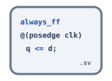
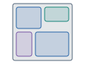
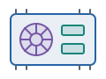

# EDA Figure Library

Editable illustrations for electronic design automation, digital ASIC design, and AI-assisted hardware research. Build a paper figure, proposal diagram, or lecture slide from transparent SVGs, vector PDFs, native diagrams.net blocks, and LaTeX templates.

[Visual gallery source](docs/index.html) · [Draw.io palette](drawio/eda-shapes.xml) · [TikZ templates](tikz) · [Resource catalog](resources) · [Licenses and credits](LICENSES.md)

## Example figures

### Complete EDA flow

[Editable SVG](examples/eda-flow.svg) · [Vector PDF](examples/eda-flow.pdf) · [Transparent PNG](examples/eda-flow.png) · [Compact TikZ template](tikz/eda-flow.tex)

The diagram follows design intent through architecture, hand-written or HLS-generated RTL, logic synthesis, physical implementation and foundry handoff. It shows representative verification and closure feedback.

### Agentic EDA flow

[Editable SVG](examples/agentic-eda-flow.svg) · [Vector PDF](examples/agentic-eda-flow.pdf) · [Transparent PNG](examples/agentic-eda-flow.png) · [Compact TikZ template](tikz/agentic-eda-flow.tex)

The diagram illustrates how specialized agents can coordinate experiments, evaluate correctness and power, performance and area (PPA), and feed evidence back into earlier design decisions. Both examples are conceptual schematics.

## Browse by EDA stage

| Preview | Stage | Editable SVGs |
| :---: | --- | --- |
|  | Specification and architecture | [Specification](icons/frontend/specification.svg), [architecture](icons/frontend/architecture.svg), [constraints](icons/frontend/constraints.svg) |
|  | RTL design | [RTL code](icons/frontend/rtl-code.svg) |
|  | High-level synthesis | [HLS](icons/frontend/high-level-synthesis.svg) |
|  | Logic synthesis | [Logic synthesis](icons/frontend/logic-synthesis.svg), [gate netlist](icons/frontend/logic-netlist.svg) |
|  | Functional and formal verification | [Functional test](icons/verification/functional.svg), [waveform](icons/verification/waveform.svg), [formal](icons/verification/formal.svg) |
|  | Floorplanning | [Floorplan](icons/backend/floorplan.svg) |
|  | Placement | [Placement](icons/backend/placement.svg) |
|  | Clock tree synthesis | [Clock tree](icons/backend/clock-tree.svg) |
|  | Routing | [Routing](icons/backend/routing.svg) |
|  | Physical verification | [Physical verification](icons/backend/physical-verification.svg) |
|  | GDSII and tape-out | [GDS layout](icons/backend/gds-layout.svg), [tape-out](icons/backend/tapeout.svg) |
|  | AI-assisted hardware design | [Agent](icons/ai/agent.svg), [evolutionary optimization](icons/ai/evolutionary-optimization.svg), [design space](icons/ai/design-space.svg), [GPU](icons/ai/gpu-compute.svg), [cross-stage feedback](icons/ai/cross-stage-feedback.svg), [loop](icons/ai/feedback.svg), [PPA](icons/ai/ppa.svg) |

## How to use the library

- **Browse and download.** Open [docs/index.html](docs/index.html) in a browser after cloning or downloading the repository. Search by title, description, source credit or license, or filter by category. A [GitHub Pages workflow](.github/workflows/pages.yml) is included. Select **Settings → Pages → GitHub Actions** as the publishing source to enable deployment.
- **Edit vectors.** Open the SVG directly in Inkscape or another vector editor. Keep text editable while composing. Use a light canvas to preserve contrast, and preview at the final print size.
- **Draw diagrams.** Load the [Draw.io palette](drawio/README.md) for 26 native elements, including editable labeled blocks and connectors. Import the SVG icons separately for detailed artwork.
- **Typeset figures.** Download a vector PDF and use `\includegraphics[width=\linewidth]{eda-flow.pdf}`, or edit the [standalone TikZ templates](tikz/README.md) for document-matched typography.
- **Credit the source.** Check the [license guide](LICENSES.md) for original figure attribution and the [manifest](resources/assets.json) for each third-party asset.

The third-party collection covers OpenROAD, OpenLane, SiliconCompiler, NetlistSVG, WaveDrom, CircuiTikZ, Tiny Tapeout, KLayout, Tabler Icons and Wikimedia Commons. The [resource catalog](resources/README.md) explains what is included and how to use each source.

## Contributing

Use transparent SVGs with a viewBox, editable paths and text, and descriptive titles. Label synthetic diagrams as conceptual. For external assets, supply a stable per-file source, the license evidence, the credit line, any restrictions and what changed. Include the corresponding notice when required.

Update [resources/assets.json](resources/assets.json), then run `python3 scripts/build.py` and `python3 scripts/validate.py`. See the [maintenance guide](resources/maintenance.md) for exports and publishing.
