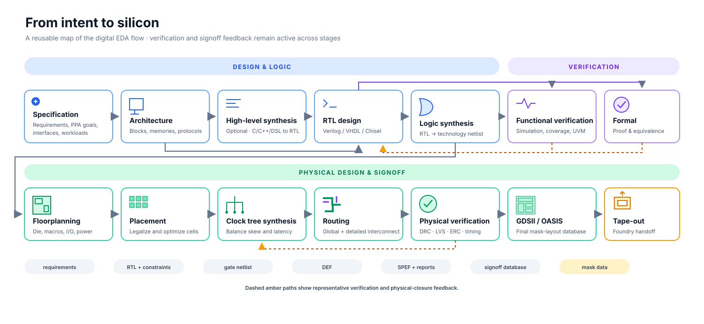
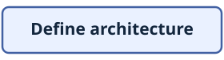
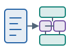
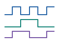
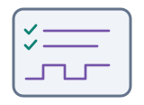
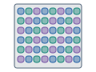

# EDA Figure Library

Editable illustrations for electronic design automation, digital ASIC design, and AI-assisted hardware research. Build a paper figure, proposal diagram, or lecture slide from transparent SVGs, vector PDFs, native diagrams.net blocks, and LaTeX templates.

[Search the visual gallery](https://fchxwh823.github.io/EDA-Figure-Library/) · [Draw.io palette](drawio/eda-shapes.xml) · [TikZ templates](tikz) · [Resource catalog](resources) · [Licenses and credits](LICENSES.md)

## Example figures

### Complete EDA flow

[Editable SVG](examples/eda-flow.svg) · [Vector PDF](examples/eda-flow.pdf) · [Transparent PNG](examples/eda-flow.png) · [Compact TikZ template](tikz/eda-flow.tex)

The diagram follows design intent through architecture, hand-written or HLS-generated RTL, logic synthesis, physical implementation and foundry handoff. It shows representative verification and closure feedback.

### Agentic EDA flow

[Editable SVG](examples/agentic-eda-flow.svg) · [Vector PDF](examples/agentic-eda-flow.pdf) · [Transparent PNG](examples/agentic-eda-flow.png) · [Compact TikZ template](tikz/agentic-eda-flow.tex)

The diagram illustrates how specialized agents can coordinate experiments, evaluate correctness and power, performance and area (PPA), and feed evidence back into earlier design decisions. Both examples are conceptual schematics.

## Browse by EDA stage

Use the labeled rectangles for **tasks** and the pictograms for **design artifacts**. A task can pass several artifacts to the next stage. The formats below are examples from digital ASIC flows. Click a rectangle or pictogram to open its editable SVG.

### Specification, architecture and logic

| EDA task | Typical inputs | Representative output | Artifact preview |
| --- | --- | --- | :---: |
|  | Workloads, requirements, PPA goals | Specification document (`.md`, `.pdf`) |  |
|  | Specification, interface requirements | Architecture block diagram |  |
|  | Architecture, interface and timing requirements | RTL source (`.sv`, `.v`, `.vhd`) |  |
|  | C, C++ or a domain-specific language and synthesis directives | Generated RTL (`.v`, `.sv`) |  |
|  | RTL, [design constraints](icons/frontend/constraints.svg) (`.sdc`), cell library (`.lib`) | Gate-level Verilog netlist (`.v`) |  |
|  | RTL or netlist, testbench and stimuli | Simulation waveform (`.vcd`, `.fst`) and coverage reports |  |
|  | RTL or netlist, properties or reference design | Proof report or counterexample trace |  |

### Physical design and signoff

| EDA task | Typical inputs | Representative output | Artifact preview |
| --- | --- | --- | :---: |
|  | Mapped netlist, LEF, die and I/O constraints | Floorplan (`.def`, `.odb`) |  |
|  | Floorplan, mapped cells, constraints | Placed layout (`.def`, `.odb`) |  |
|  | Placed design and clock constraints | Post-CTS layout (`.def`, `.odb`) with a buffered clock tree |  |
|  | Post-CTS design, routing layers and rules | Routed layout (`.def`, `.odb`) |  |
|  | Routed design, cell and macro geometry, layer mapping | Mask layout (`.gds`, `.oas`) |  |
|  | Layout, rule decks and reference netlist | DRC/LVS reports and violation markers |  |
|  | Signed-off mask layout and required reports | Foundry-specific delivery package |  |

A Verilog **netlist** describes cell instances and which pins share a logical net. Routing adds the physical wire and via geometry to the **routed layout**, typically stored in DEF or OpenDB. Some flows also export an updated netlist after routing, for example when implementation changes cell instances or logical connectivity. The GDSII icon shows separate mask layers as an exploded view of planar polygons. See [OpenLane’s detailed-routing and stream-out documentation](https://openlane2.readthedocs.io/en/latest/reference/step_config_vars.html#detailed-routing).

### AI-assisted hardware design

[Agent](icons/ai/agent.svg) · [Evolutionary optimization](icons/ai/evolutionary-optimization.svg) · [Design space exploration](icons/ai/design-space.svg) · [GPU](icons/ai/gpu-compute.svg) · [Cross-stage feedback](icons/ai/cross-stage-feedback.svg) · [Feedback loop](icons/ai/feedback.svg) · [PPA](icons/ai/ppa.svg)

## How to use the library

- **Browse and download.** Open the [published gallery](https://fchxwh823.github.io/EDA-Figure-Library/) or open [docs/index.html](docs/index.html) locally after downloading the repository. Search by title, description, artifact format, source credit or license, or filter by category.
- **Edit vectors.** Open the SVG directly in Inkscape or another vector editor. Keep text editable while composing. Use a light canvas to preserve contrast, and preview at the final print size.
- **Draw diagrams.** Load the [Draw.io palette](drawio/README.md) for editable task rectangles, artifact blocks and connectors. Import the SVG icons separately for detailed artwork.
- **Typeset figures.** Download a vector PDF and use `\includegraphics[width=\linewidth]{eda-flow.pdf}`, or edit the [standalone TikZ templates](tikz/README.md) for document-matched typography.
- **Credit the source.** Check the [license guide](LICENSES.md) for original figure attribution and the [manifest](resources/assets.json) for each third-party asset.

The third-party collection covers OpenROAD, OpenLane, SiliconCompiler, NetlistSVG, WaveDrom, CircuiTikZ, Tiny Tapeout, KLayout, Tabler Icons and Wikimedia Commons. The [resource catalog](resources/README.md) explains what is included and how to use each source.

## Contributing

Use transparent SVGs with a viewBox, editable paths and text, and descriptive titles. Label synthetic diagrams as conceptual. For external assets, supply a stable per-file source, the license evidence, the credit line, any restrictions and what changed. Include the corresponding notice when required.

Update [resources/assets.json](resources/assets.json), then run `python3 scripts/build.py` and `python3 scripts/validate.py`. See the [maintenance guide](resources/maintenance.md) for exports and publishing.
